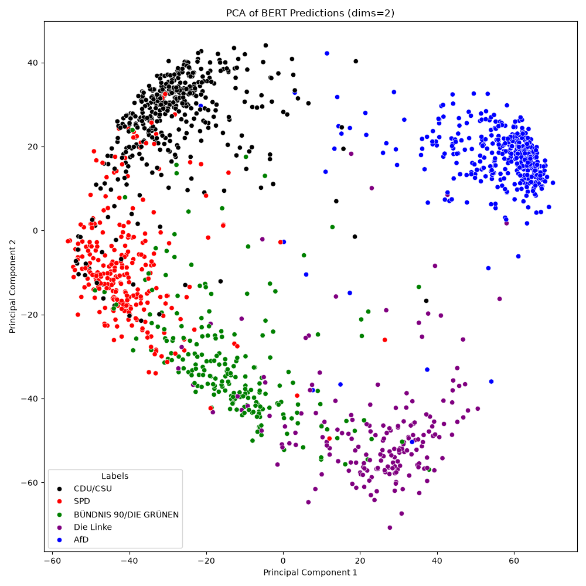
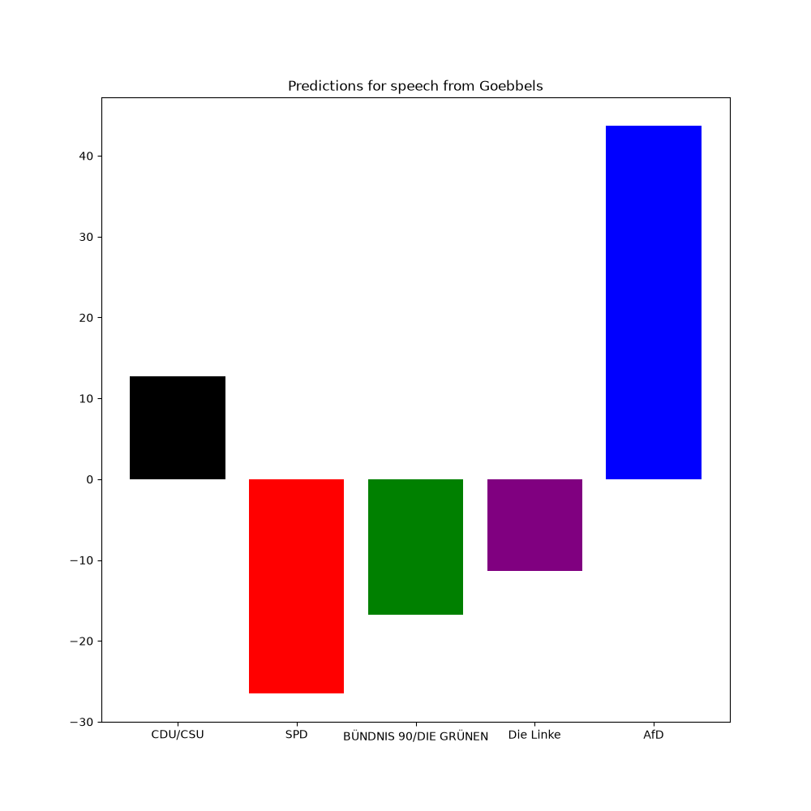

# Party Predictor (Parteien-Klassifikator)
*Eine englische Version kann unter [English README](README.md) gefunden werden.*\
*Achtung: Die deutsche Version ist nicht up to date!*\
Der europaweite Trend zu rechter Politik hat auch Deutschland nicht verfehlt. Doch inwiefern kann dies an im Bundestag gehaltenen Reden nachvollzogen werden?\
Wir haben tausende Reden der Parteien AfD, CDU/CSU, Bündnis_90/Die Grünen, SPD und der LINKEn analysiert..\
Hierzu finetuneten wir ein deutsches BERT-Modell auf Klassifikation von Reden in Parteigruppen und analysierten die Ursachen für die gegebenen Klassifikationen. Diese verglichen wir anschließend mit verschiedenen historischen Reden unterschiedlicher gemäßigter und extremer politischen Richtungen, um Gemeinsamkeiten und Unterschiede feststellen zu können. 

# Getting started
Du willst unser wunderschönes Tool verwenden ohne auch nur eine Sekunde darauf zu verschwenden, unseren supersauberen Code zu genießen. Auch wenn uns dieses Verhalten äußerst suspekt erscheint, haben wir für Dich eine kleine Übersicht an Befehlen zusammengestellt, durch die Du Dich durchhangeln kannst. So kannst Du unseren Code auch verwenden, wenn Du keine Tuten und Blasen von Programmieren hast (vorausgesetzt Du verwendest Linux und hast Python bereits installiert).

## Setup
Egal was komme, führe diesen Code aus (Vertraue uns, was ist das Schlimmste, das passieren könnte, hmm?)\
1. Clone das Repository
   ```bash
   git clone https://github.com/thisisjustausername/party_predictor.git
   cd party_predictor
   ```
2. Installiere Dependencies\
  Wir empfehlen, uv als Paketmanager zu verwenden, aber pip funktioniert auch (gegebenenfalls etwas langsamer). Verwende zudem mindestens Python3.13. Die neuesten verwendeten Features wurden in Version 3.7 hinzugefügt, allerdings benötigen die Libraries häufig höhere Versionen.
    * uv
      ```bash
      # Install virtual environment
      uv venv --python 3.13 venv
      source venv/bin/activate
      
      # Install dependencies
      uv pip install -r requirements.txt
      ```
    * pip
      ```bash
      # Install virtual environment
      python3 -m venv venv
      source venv/bin/activate
      
      # Install dependencies
      pip3 install -r requirements.txt
      ```

3. Initialisiere die ENV-Variablen\
  Recherchiere hierfür den API-Schlüssel der Bundestags-API und ersetze `<Input your API Key here>` im folgenden Code-Snippet damit.
    ```bash
    # Create .env file
    touch .env
    echo "API_KEY=<Input your API Key here>" >> .env
    ```

4. Lade das BERT-Modell und die Metriken von HuggingFace herunter.\
  Optional: Garantiere einen schnelleren Download indem Du zuerst `hf auth login` in deinem Terminal ausführst, um dich bei HuggingFace anzumelden.
   ```bash
   python3 -m bert.download.download_bert

   python3 -m bert.download.download_metrics
   ```

5. Viel Spaß mit dem Code. Beachte, dass alle Dateien mit absoluten Imports geschrieben wurden und daher aus dem Root-Verzeichnis des Repositories gestartet werden müssen.
   ```bash
   # THIS FILE DOESN'T EXIST. Simply a placeholder for files you want to run.
   # Check for correct file path
   [[ "$(basename "$PWD")" == "party_predictor" ]] || {echo 'Please run this file from the root directory of the repository.';}
   
   # Run file
   python3 -m bert.test_python_file
   ```

## Trainings-Pipeline
Falls Du das BERT-Modell selbst finetunen willst, verwende diese Pipeline. Wir empfehlen dringend, eine NVIDIA GPU mit mindestens 40GB VRAM und einer Ampere-Architektur zu verwenden.
1. Lade die Daten herunter und bereite sie vor
   ```bash
   # Download data
   python3 -m dataset_generation.fetch_data
   
   # Preprocess data
   python3 -m dataset_generation.clean_data
   
   # OPTIONAL: For the interested ones
   python3 -m dataset_generation.investigate_data
   ```

2. Trainiere das Modell\
  Wenn Du willst, kannst Du die Parameter für das Lernen in der Datei `bert/parameters.py` anpassen.\
  Wähle für `NUM_GPUS` die Anzahl an GPUs, die Du für das Training verwenden willst.
   ```bash
   # Create directories for model stats and finetuned models
   mkdir finetuned_model_stats
   mkdir finetuned_models
   
   # Train model
   torchrun --nproc_per_node=<NUM_GPUS> -m bert.train
   ```

3. Evaluiere das Modell
   ```bash
   python3 -m bert.label_test
   ```

### Faktoren

## Modell-Resultate
Das Training von ModernBERT dauert auf der genannten Hardware circa 7 Stunden (auf 2 GPUs, 13h auf 1 GPU) und verbraucht circa 4 kWh, um einen F1-Score von etwa 0,87 zu erreichen.\
Die Variante mit Standard-BERT erfordert häufig ein Chunking der Reden, übertrifft den ModernBERT-Ansatz in puncto Trainingsgeschwindigkeit aber deutlich und benötigt zudem weit weniger Ressourcen: Sie läuft bereits auf einer NVIDIA RTX 5000 Mobile (110W) mit 16GB VRAM bei 4 min/Epoche. Für Training und Evaluation wurden bei einer Batch Size von 4 und 4 Accumulation Steps weniger als 3GB VRAM benötigt.

Das aktuell beste Modell wurde auf einem Trainings-Split von 65% der Daten trainiert (gemischt und zufällig ausgewählt).\
Die Hyperparameter wurden auf einem Validierungsset getunt, das 15% des Datensatzes enthielt.\
Abschließend wurde das Modell nach dem Training auf einem Testset evaluiert, das 20% des Datensatzes ausmacht.\
Auf den Testdaten haben wir folgende Werte erzielt:

*Standard BERT*\
__Parameter__
| Parameter | Wert |
| --------- | ----- |
| model | google-bert/bert-base-german-cased |
| context length | 512 tokens |
| batch size | 24 |
| epochs | 32 |
| learning rate | 3e-5 |
| betas | (0.9,0.999) |
| epsilon | 1e-08 |
| seed | 42 |
| loss | CrossEntropyLoss |
| Optimizer | AdamW |
| Scheduler | LambdaLR |
| Classifier | single linear layer (no activation func) |

__Resultate__ (nicht-reproduzierbar)
| Measure | Wert |
| ------- | ----- |
| F1-Score | 0.95 |
| Precision | 0.95 |
| Recall | 0.94 |
| Accuracy | 0.94 |

__Resultate__ (reproduzierbar)
| Measure | Wert |
| ------- | ----- |
| F1-Score | 0.82 |
| Precision | 0.82 |
| Recall | 0.80 |
| Accuracy | 0.82 |

\
*Modern BERT*\
__Parameterer__
| Parameter | Wert |
| --------- | ----- |
| model | LSX-UniWue/ModernGBERT_1B |
| context length | 2500 tokens |
| batch size | 16 |
| epochs | 32 |
| learning rate | 3e-5 |
| betas | (0.9,0.999) |
| epsilon | 1e-08 |
| seed | 42 |
| loss | CrossEntropyLoss |
| Optimizer | AdamW |
| Scheduler | LambdaLR |
| Classifier | single linear layer (no activation func) |

__Resultate__
| Maß | Wert |
| ------- | ----- |
| F1-Score | 0.88 |
| Precision | 0.88 |
| Recall | 0.88 |
| Accuracy | 0.89 |

Diese Ergebnisse sind vergleichsweise gut, weshalb wir mögliche Probleme im Training, die zu einem überdurschnittlich gut erscheinenden Ergebnis führen, hervorheben wollen.\
Zwar vermeiden wir Data Leakage vollständig, implizite Information Leakage wurde jedoch noch nicht behandelt. So könnte ein Redner beispielsweise seine Kollegen erwähnen oder positiv über die eigene Partei sprechen. Daher muss beispielsweise NER einsetzt werden, um Namen, Organisationen und andere Informationen zu maskieren, die einen Hinweis auf die Partei geben, ohne für dieses Projekt relevante Informationen zu enthalten.\
Generell haben wir die Daten auf solche Informationslecks untersucht und dabei wenig problematische Instanzen gefunden. Wir gehen deshalb davon aus, dass dies nur einen geringen Einfluss auf die Resultate hat.\
Trotzdem nehmen wir an, dass das Testset nicht vollständig ausbalanciert ist und daher bessere Ergebnisse als erwartet liefern könnte.

## Inferenz
Gemessen am F1-Score erweist sich `model_6_latest` als das leistungsstärkste Modell; alle folgenden Ergebnisse beziehen sich somit auf dieses Modell.

## Visualisierung der Klassifikationsergebnisse
Zu beachten ist, dass die Cluster stark vom verwendeten Modell abhängen. Dies lässt sich durch den Vergleich einiger Visualisierungen im Ordner `finetuned_model_visualized` nachvollziehen.\
Dabei ist zu betonen, dass sich die Achsen von Diagramm zu Diagramm unterscheiden, da jede Darstellung einzeln mittels PCA auf zwei Dimensionen reduziert wird.\


Exemplarisch klassifizieren wir einen Ausschnitt aus einer Rede von Goebbels (dem Propagandaminister des Dritten Reiches) und bilden ihn auf den Raum der Reden der gegenwärtig im Bundestag vertretenen Parteien ab.\


## Explain classifications

[TODO: finish]: #

# TODOs
* Verwende eine NER-Maske, um die Klassifizierung nicht von Namen von Personen und Organisationen in den Reden abhängig zu machen
* Das Training durch Festlegen von Zufallsstartwerten (Random Seeds) deterministisch gestalten.
* Implizite Informationslecks (Information Leakage) vermeiden.

# Malicious use cases
Das Tool kann für politische Zwecke missbraucht werden. Abgewandelt kann es die Erfolgsfaktoren von bekannten und überzeugenden Reden analysieren und in neuen Reden nachahmen. Dies kann verwendet werden, um populistische und manipulative Reden zu generieren. Es ist anzumerken, dass extreme Reden in den Trainingsdaten enthalten sein können, da diese in diesem Projekt auch analysiert werden können sollen.
